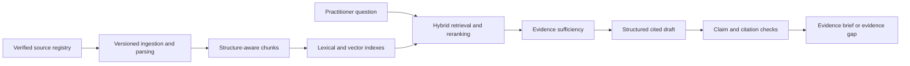

# EvidenceLens

**Traceable supplement evidence for practitioners, built around measurable RAG engineering.**

EvidenceLens is a planned evidence research application that helps practitioners investigate supplement claims, compare findings, and inspect the original passages behind an answer. Its engineering focus is reliable retrieval, evidence provenance, calibrated abstention, and reproducible scaling experiments.

**Status: architecture and development plan, 19 October 2026.** No application, benchmarks, cloud infrastructure, or clinical validation has been implemented. All performance numbers in these documents are proposed targets or explicitly labelled calculations.

## What EvidenceLens will do

Practitioners will be able to investigate a supplement question, audit a published claim, and inspect disagreement between sources. Each evidence brief will connect findings to original passages and preserve study populations, formulations, doses, durations, outcomes, and limitations. Unsupported questions should produce an explicit evidence gap rather than an invented answer.

## Architecture

Start with the [master development plan v1.0.0](docs/planning/master-plan-v1.0.0.md): 24 features, 72 work units, acceptance criteria, dependencies, release gates, and open decisions. The master and supporting planning documents are frozen; future intent changes use [child editions](docs/planning/README.md) referencing the original. The [architecture](docs/architecture.md), [phase estimates](docs/development-plan.md), [evaluation specification](docs/evaluation.md), and [scaling model](docs/scaling.md) provide baseline detail. The optional [interactive planning overview](planning/evidence-lens.canvas.tsx) is an earlier navigation/sizing aid, not the authoritative master.

The initial workflow is a practitioner asking an evidence question or submitting a published claim. The application returns a structured brief with findings, population and formulation context, conflicting evidence, limitations, and passage-level citations. Public research and commentary are in scope; patient records and individual prescribing workflows are outside the initial product scope.

The proposed first corpus covers magnesium, vitamin D, omega-3, and creatine. This is an engineering scope assumption to validate in Phase 0, not a claim that these topics already have sufficient collected evidence. Source types can expand without changing the evidence contract.

The core design uses Python and FastAPI, PostgreSQL, versioned object storage, OpenSearch for lexical and vector retrieval, and separate ingestion workers. AWS is the proposed reference deployment, with container-based local development. Model and parser selections are benchmark decisions, not fixed promises.

## Engineering approach

- Reuse maintained libraries and framework conventions before introducing custom infrastructure.
- Apply SOLID, composition, narrow interfaces, and design patterns where they solve concrete problems.
- Treat source documents as untrusted input; map security controls to applicable OWASP guidance.
- Compare retrieval strategies with fixed datasets, versioned configurations, and reproducible experiments.
- Report quality, useful answer coverage, latency, reliability, and cost together.
- Keep implementation small and purposeful; no speculative services or architecture for its own sake.

Read the [engineering standards](docs/engineering-standards.md), [contribution workflow](CONTRIBUTING.md), and [agent guidance](AGENTS.md). [Spec Kit and selected ECC skills](docs/agent-tooling.md) work together across the entire application: specifications and tasks guide delivery, reuse research informs design, and verification evidence gates completion. The [feature index](specs/README.md) links this workflow to every roadmap phase. Official Spec Kit integrations are included for Codex, Claude Code, and Cursor; upstream assets retain their MIT notices.

## Roadmap and current use

Development checks run locally. GitHub Actions is disabled and will only be introduced upon the project owner's explicit instruction. See the [local verification commands](docs/agent-tooling.md).

The project progresses through evidence contracts, ingestion, a usable baseline, retrieval optimization, claim verification, a cloud pilot, scale experiments, failure recovery, and portfolio publication. There is no runnable application or installation command yet. The useful starting point today is the architecture and development plan.

The project is built around reproducible experiments: what failed, what changed, how quality and operational behavior changed, and what the change cost. Ten million documents is a long-term capacity scenario; every release will state the largest workload actually tested. No zero-hallucination or clinical-validation claim is made.

## Contributing and security

Focused feedback on evidence workflows, retrieval evaluation, and architecture is welcome. Read [CONTRIBUTING.md](CONTRIBUTING.md) before proposing implementation changes and [SECURITY.md](SECURITY.md) for reporting sensitive issues.

## License and data

Original project material is licensed under [Apache License 2.0](LICENSE), except where otherwise indicated. Selected ECC-derived skills retain their [MIT license](third_party/ecc/LICENSE); generated Spec Kit assets retain their [MIT license](third_party/spec-kit/LICENSE). Third-party libraries, models, datasets, and source documents keep their own licenses. Public accessibility does not establish redistribution permission; the project license does not relicense its evidence corpus.

Apache 2.0 is a permissive open-source license and permits proprietary derivatives subject to its terms.
