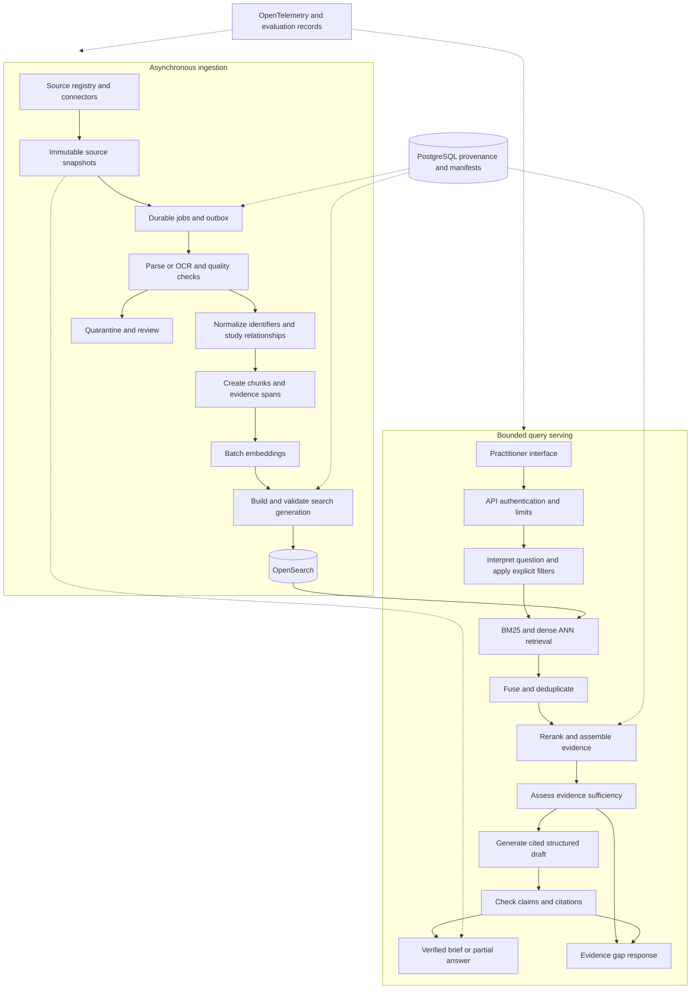

# EvidenceLens architecture

Draft dated 19 October 2026. This is the proposed design; implementation and measured results will be added through the development phases.

EvidenceLens helps practitioners investigate supplement evidence across research and credible public commentary. The main architectural decision is to separate an asynchronous, replayable ingestion pipeline from a bounded query pipeline. Both depend on versioned evidence records so that source changes, model changes, and retrieval changes can be evaluated and traced.

## Product requirements and boundaries

The primary user is a practitioner reviewing a supplement question or checking a claim made in an article, blog, or creator transcript. The output is an evidence brief rather than an unstructured chat response.

A brief contains the question as interpreted, findings with citations, studied populations, formulations, reported doses and durations, outcomes, limitations, conflicting findings, missing evidence, and the corpus snapshot date. Reported study doses are explicitly distinguished from practitioner recommendations. An absent mention of a safety issue must never become a claim that no issue exists.

Three workflows guide the first implementation:

1. **Investigate a question:** find relevant evidence and explain its scope.
2. **Audit a public claim:** identify the claim, follow its references, and compare it with original evidence.
3. **Inspect disagreement:** show whether apparent conflict concerns genuinely comparable populations, formulations, endpoints, and time periods.

English content and questions are the first release scope. Proposed seed topics are magnesium, vitamin D, omega-3, and creatine. Patient uploads, individualized treatment plans, comprehensive systematic-review claims, and automated clinical decisions require a separate product decision. They are not necessary to demonstrate the RAG architecture.

The MacBook Pro with M5, 24 GB RAM, and 1 TB storage is a development environment. Local runs use bounded corpus snapshots and resource profiles. Production limits are established through cloud benchmarks, not inferred from the laptop.

## Evidence policy

Accept diverse sources when identity, provenance, access conditions, and domain relevance can be established. Journal prestige and author reputation are contextual metadata, not automatic truth scores.

Keep six assessments distinct: provenance, author expertise, evidence type, underlying support, disclosed interests and limitations, and applicability to the specific question. Missing information remains unknown rather than receiving a favorable default.

Research articles, guidelines, expert commentary, newspapers, magazines, practitioner case studies, and creator content retain their original types. A newspaper can establish what it reported; a creator transcript can establish what the creator claimed. Neither automatically establishes a treatment effect. Several articles derived from one study must not be treated as independent corroboration.

Source acquisition priorities:

- **NIH Office of Dietary Supplements:** seed practitioner-facing summaries and reference discovery. ODS publishes fact sheets for health professionals covering supplement evidence and safety topics. [ODS health information](https://ods.od.nih.gov/HealthInformation/healthinformation.aspx)
- **PMC Open Access subset:** acquire eligible full text through authorized services and retain each article's license. PMC explicitly states that not all its articles are available for reuse and restricts automated retrieval to named services. [PMC access and reuse](https://pmc.ncbi.nlm.nih.gov/tools/openftlist/)
- **Research metadata:** use permitted metadata interfaces to resolve identifiers and references. Abstract-only records remain labelled abstract-only; missing full text must not be represented as reviewed full text.
- **Curated commentary:** add an initial allowlist of expert sites, publishers, and creator transcripts after recording identity, attribution, permissions, and update policy. Following a citation does not bypass the destination's acquisition rules.
- **Books and practitioner material:** add public-domain, appropriately licensed, or explicitly supplied material once permission and provenance are recorded. Defer identifiable patient material.

Maintain a source registry with URL/domain, owner, author verification evidence, source category, collection method, license, retention/redistribution rules, crawl interval, jurisdiction when relevant, review date, and approval status. Prefer structured APIs and XML; use scraping only where appropriate. No particular creator or publisher has been approved yet.

## System boundaries

These are logical boundaries, not a requirement to deploy a microservice for every box. Start with one typed Python codebase, a query API process, and ingestion worker processes. Extract independently deployed services when measurements show different scaling or reliability requirements.

## Proposed stack and rationale

**Python, FastAPI, and typed schemas** form the API and pipeline contracts. A React/TypeScript interface provides question entry, evidence inspection, and feedback. Keep orchestration explicit in ordinary code so retrieval decisions and retries are testable. A framework adapter may help individual steps, but it must not own undocumented state.

**PostgreSQL** stores provenance, source policies, jobs, study relationships, feedback, evaluation manifests, and index-release metadata. Raw documents and bulky parser artifacts live in versioned object storage. PostgreSQL does not need a separate database row for every full-text chunk at large scale; partitioned chunk manifests and search indexes carry the high-volume representation.

**OpenSearch** is the initial search backend for BM25, vectors, filters, and index aliases. Keeping both retrieval modes in one engine reduces the number of independently updated search stores. Its hybrid search supports score normalization and rank-based fusion. Compare native fusion with explicit fusion in the retrieval service under one pinned configuration. [OpenSearch hybrid search](https://docs.opensearch.org/latest/vector-search/ai-search/hybrid-search/index/)

**Qdrant is an optional comparative experiment**, not an additional production dependency at launch. Introduce a separate vector backend only if measured memory, latency, or relevance benefits justify extra synchronization and operations. Its distributed capabilities provide a useful comparison target, but deployment details must be validated for the chosen version. [Qdrant distributed deployment](https://qdrant.tech/documentation/distributed_deployment/)

**Local execution** uses Docker Compose, single-node OpenSearch, PostgreSQL, local file-backed object storage through an adapter, and a PostgreSQL-backed leased work queue. Run expensive parsing and embedding jobs with bounded concurrency; an external model endpoint can keep generation off the laptop. A fully local model profile can be added separately.

**Reference cloud deployment** uses AWS S3, RDS PostgreSQL, OpenSearch Service, SQS with dead-letter queues, ECS services for the API and workers, and Terraform. Fargate is an option for CPU workloads; self-hosted GPU inference requires a compatible GPU platform such as EC2-backed capacity. An API model provider is the initial generation path, behind a provider interface. AWS is an assumption for a concrete deployment example, not a locked vendor commitment.

**OpenTelemetry** records traces, metrics, and logs; choose one compatible visualization backend rather than duplicating telemetry stacks. [OpenTelemetry signals](https://opentelemetry.io/docs/concepts/signals/)

## Evidence and version contracts

Define these entities before implementing connectors:

- **Source:** identity, collection policy, permission record, review status.
- **Document:** stable source identity, canonical URL, DOI/PMID/PMCID when present, source type, publication date.
- **Document version:** raw content hash, fetched timestamp, source modification date, license snapshot, parser version, availability/retraction status.
- **Evidence span:** version ID, section path, original page or stable HTML/XML offsets, quoted text hash, table coordinates where available, extraction quality flag. Never invent a page number for HTML.
- **Chunk:** deterministic ID, parent section, evidence span references, text hash, tokenizer/chunker version, token count, and embedding version.
- **Study:** verified identifier and links to publications about it. Uncertain study matches remain candidate links; a heuristic must not silently merge independent studies.
- **Claim:** verbatim source claim or generated atomic claim, claim origin, qualifiers, supporting or contradicting spans, and verification outcome.
- **Index release:** physical index identifier, embedding model revision and dimensions, chunking config, source manifest, build status, evaluation results, and release timestamp.
- **Query run:** request ID, interpreted question, explicit filters, retrieved IDs and ranks, context span IDs, model/prompt/config versions, output claims, verification results, stage timing, usage, and failure reason.

An evidence brief carries the index release and source version references used to produce it. This enables replay of the evidence path even when a hosted model is not bit-for-bit reproducible.

## Ingestion and publishing

1. Discover source changes through connector watermarks and permitted update interfaces. Store original bytes, content hash, fetch metadata, and policy decision before processing.
2. Route structured XML/HTML to lightweight parsers; route PDFs and scans to a document parser/OCR profile. Docling is a candidate for document conversion, with format-specific quality tests rather than an assumption of perfect extraction. [Supported formats](https://docling-project.github.io/docling/usage/supported_formats/)
3. Quarantine malformed documents, poor OCR, ambiguous tables, and missing provenance. Failed items remain visible in ingestion accounting.
4. Normalize identifiers, bibliographic references, ingredient aliases, and units while retaining original values. Do not conflate a chemical compound's mass with elemental nutrient mass or infer missing conversions.
5. Deduplicate exact content and cluster likely near-duplicates. Keep original publications for provenance and citation; suppress repeated evidence in context assembly rather than destroying source history.
6. Chunk by section and document structure. Starting experiments compare fixed token windows with 300–600-token section-aware children and larger parent context. These are candidate sizes to tune. Keep captions, table headers, units, and footnotes connected; do not flatten a table into unsupported prose.
7. Batch embedding work by token count and model revision. Cache by normalized text hash, preprocessing config, and model revision. Never mix vectors from different model spaces in one searchable field.
8. Publish only completed, validated document versions. A new version becomes query-eligible only after its expected chunks and metadata are present. The query service validates active-version status before using candidates and overfetches to compensate for superseded hits.
9. For embedding/chunking migrations, build a new physical index, run shadow evaluation, and switch the serving alias after validation. Resolve and pin one physical index per query to avoid a mid-request alias change. Retain the previous generation for a bounded rollback period.

Use at-least-once work delivery plus idempotent stages. The idempotency key includes document version, stage, and stage configuration hash. Durable completion records, leases, retry budgets, backoff, poison-item quarantine, and an outbox prevent a database commit from silently losing downstream work. SQS can redeliver messages, so duplicate handling is required in the cloud too. [SQS delivery semantics](https://docs.aws.amazon.com/AWSSimpleQueueService/latest/SQSDeveloperGuide/standard-queues-at-least-once-delivery.html)

Partition ingest work by stable identifiers; avoid one enormous job. Separate OCR, embedding, and indexing worker pools once they have materially different resource demands. Autoscaling follows backlog age and throughput as well as CPU. Apply admission control so a bulk import cannot consume query-serving capacity.

Source deletion or retraction first changes query eligibility and invalidates dependent caches, then removes or marks derived records. Preserve historical evidence only where permitted and explicitly labelled; revoked content must not remain available through an old cache or rollback index. Rollback always applies current exclusions.

## Query and answer pipeline

1. **Validate and interpret.** Authenticate, rate-limit, bound input size, and identify ingredient, population, formulation, outcome, and time scope. Retain the original question. Ask for clarification when an ambiguity materially changes retrieval. Do not turn inferred attributes into hard filters.
2. **Retrieve.** In the initial candidate configuration, retrieve up to 100 BM25 and 100 dense ANN candidates using explicit source/date constraints. Keep exact identifiers and numeric terms in the lexical query. Query expansion preserves the original query and records aliases used.
3. **Fuse and deduplicate.** Start with reciprocal rank fusion. Deduplicate chunks and limit domination by a single study or source. Candidate count and fusion settings are experiment variables, not quality guarantees.
4. **Rerank.** Score roughly 40–60 fused candidates with a cross-encoder candidate model. Measure truncation and long-passage handling. If reranking fails, return a clearly labelled retrieval-only result or retry within budget; do not silently present an unverified generated brief.
5. **Build context.** Select approximately 8–12 passages within an initial 8,000-token evidence budget, subject to the selected model's limits. Expand parent context only when needed for qualifiers. Include contradictory and limiting evidence when found, and keep study coverage visible.
6. **Check sufficiency.** Determine whether evidence addresses the question's required attributes. Allow one bounded follow-up retrieval for a specific missing attribute; then answer supported parts or abstain. A similarity score is not a correctness probability. Google research distinguishes insufficient context from failures to use sufficient context. [Sufficient context research](https://research.google/pubs/sufficient-context-a-new-lens-on-retrieval-augmented-generation-systems/)
7. **Generate a structured draft.** Supply cited evidence as untrusted data and require atomic claims, evidence IDs, qualifiers, and gaps. The generator cannot create URLs or retrieve arbitrary external content itself. Public-page instructions are never executed.
8. **Verify before release.** Resolve citation IDs to actual spans; check citation support, numbers, units, population, direction of effect, and unsupported generalizations. Recheck current source eligibility and authorization immediately before releasing content, including cached responses, so an in-flight deletion does not bypass policy. Combine deterministic checks with a separately evaluated entailment/judge model and sampled human review. Automated verification can fail; it is not proof of clinical correctness.
9. **Release or reduce.** Permit one bounded revision. Remove unsupported claims, disclose partial coverage, or return an evidence-gap response. Stream progress first; stream factual answer text only after its release checks pass. Do not expose an unverified draft as the final answer.

Keep source quality, query relevance, evidence sufficiency, and claim support separately inspectable. Calibration happens on labelled development examples. Avoid a single opaque trust percentage and avoid requiring consensus when the relevant evidence is genuinely conflicting.

## Caching and model deployment

Start with embedding caches and exact-query retrieval caches. Keys include query, filters, authorization scope, active index release, retrieval config, and current exclusion-policy version. Answer caches additionally include prompt, generator, verifier, and output-schema versions. Validate policy eligibility on every hit and expire entries when dependent sources change.

Defer semantic answer caching until near-identical questions with different doses, populations, or formulations have been tested. Never reuse an answer solely because two embeddings are close. Keep private-user caches scoped if private content is introduced later.

Benchmark at least a general-purpose and a biomedical retrieval model under the same corpus. Select one small reranker and one generation model for the first release, then compare alternatives when error analysis justifies it. Pin model revisions, normalization, dimensions, and tokenizer settings. Include hosted inference rate limits and tail latency in capacity tests.

## Operations and recovery

Separate ingestion and query resource budgets. Autoscale the API by demand and workers by useful backlog measures; ECS supports target-based service scaling. Bound scaling by maximum replicas and a run budget. [ECS scaling](https://docs.aws.amazon.com/AmazonECS/latest/developerguide/service-autoscaling-targettracking.html)

Measure per-stage latency, retrieval candidate coverage, duplicate rates, verifier failures, abstention, queue age, parse/OCR failure rate, embedding cache hits, search heap/disk pressure, model throttling, and cost per request and per ingested unit. Record token counts; do not describe traces as access to hidden model reasoning.

Use timeouts, bounded retries, circuit breakers, and load shedding. Degraded modes must be explicit: evidence search without generation, a partial answer, or temporary unavailability. Health checks must not classify an outage-induced abstention as a successful evidence decision.

Before external deployment, implement authentication, least-privilege credentials, secrets management, encrypted transport/storage, redacted telemetry, dependency scanning, and controlled connector egress. URL ingestion requires SSRF protection, redirect validation, download limits, and parser isolation. Source instructions cannot override the system's evidence policy. Request content is not logged wholesale by default.

Back up PostgreSQL and source artifacts, test index reconstruction, and perform a restore drill. Proposed initial objectives are a 24-hour metadata recovery point and a four-hour service recovery time for the declared demo corpus; verify or revise these before claiming them. Search indexes are rebuildable, but their rebuild time must be measured. Availability and recovery promises apply only to a tested deployment profile.

## Decisions deferred to evidence

The initial design does not need a dedicated graph database, agent framework, Kubernetes, fine-tuned generator, or ten million domain documents. Study/citation edges in PostgreSQL support the first relationship traversal. Add graph retrieval, fine-tuned reranking, extra services, or alternate search backends only when a specific failure class or measured bottleneck justifies the additional system.

Open decisions are the practitioner-reviewed question set, source allowlist, cloud budget, model endpoint permissions, and chosen AWS region or alternative cloud. Phase 0 resolves them without blocking the architecture draft.
